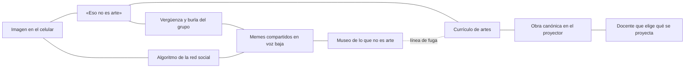

> [!info] Ejemplo ilustrativo
> Este caso es inventado con fines didácticos. No contiene datos de personas reales. Muestra cómo se ve, de principio a fin, una investigación cartográfica pequeña.

## Pregunta y entrada

**Pregunta:** ¿Cómo se producen y se transforman los modos de mirar imágenes en un curso de artes visuales de grado décimo?

**Entrada al campo:** una sesión en la que se pide a los estudiantes llevar al aula una imagen de su celular que les guste. Se eligió esa entrada porque allí se cruzan la imagen escolar y la imagen cotidiana.

**Implicación:** quien investiga es también el docente del curso. Lo declara desde el inicio y lo registra en el diario cada vez que su papel de profesor pesa sobre lo que ocurre.

**Materiales:** diario del cartógrafo, fotografías de la pizarra, las imágenes que llevan los estudiantes (con consentimiento), conversaciones grabadas en clase y un mapa que los estudiantes dibujan al final.

## La atención del cartógrafo

| Gesto | Qué ocurrió en el ejemplo |
|---|---|
| **Rastreo** | Las primeras sesiones se registran sin foco: qué imágenes llegan, quién las muestra, qué se dice. |
| **Toque** | Un estudiante se niega a proyectar su imagen y dice: «eso no es arte». La frase detiene la atención. |
| **Aterrizaje** | El diario se concentra en esa frontera: ¿qué imágenes pasan al proyector y cuáles se quedan en el celular? |
| **Reconocimiento atento** | Se sigue qué conecta esa frontera: el currículo, la burla del grupo, los memes, el algoritmo de la red social. |

## Mapa de conexiones

## Líneas

- **Línea dura:** el currículo y el proyector separan lo que es arte de lo que no lo es. Solo las obras canónicas suben a la pantalla.
- **Línea flexible:** el grupo negocia esa frontera con memes que circulan en voz baja, por fuera del proyector.
- **Línea de fuga:** los estudiantes proponen montar un «museo de lo que no es arte» con sus imágenes. La frontera se convierte en tema de trabajo.

## Escritura en mesetas

1. **Meseta «Eso no es arte».** Cómo una frase hace visible una frontera que el currículo daba por natural.
2. **Meseta del proyector.** El proyector como dispositivo que decide qué se ve en común: un pequeño régimen de visibilidad dentro del aula.
3. **Meseta del museo.** Cómo una línea de fuga se convierte en proyecto colectivo y qué cambia en la mirada del grupo.

Cada meseta cita fragmentos del diario y de las conversaciones, piensa con un concepto (frontera, dispositivo, devenir) y termina con las preguntas que deja abiertas. El mapa se devuelve al grupo, que lo corrige y le agrega conexiones.

## Qué queda registrado

- El diario con las fechas de cada gesto de atención.
- Las versiones del mapa, antes y después de discutirlo con los estudiantes.
- Las decisiones de diseño que cambiaron en el campo (por ejemplo, agregar el museo como material).

> [!warning] Lo que este ejemplo no hace
> No clasifica a los estudiantes en tipos de mirada ni generaliza a otros cursos. Su aporte es mostrar cómo se produce y se transforma una frontera de lo visible en un aula concreta.

Volver al [[index|inicio]] o a [[06 Diseñar una investigación rizomática|Diseñar una investigación rizomática]].
